# Ansible Configuration Management
# Ansible Static Roles with Jenkins and GitHub
Ansible project for managing Linux hosts over SSH. It includes a small
environment inventory, a playbook for common host maintenance, and a role
that installs Apache and publishes the HTML content of a separate website
repository to UAT/Dev web servers.
### For the tasks linux/ubuntu servers were used instead of RHEL8 due to cost consideration on cloud.


------------------------------------------------------------------------

## What this repository does

- Defines development and UAT hosts in Ansible inventory files.
- Installs or removes Wireshark on the `nfs` and `web` groups.
- Creates a temporary directory and file, configures the timezone to
  `Africa/Nairobi`, and run a script remotely that reports basic server information.
- Installs Apache and Git on UAT hosts, clones the
  `tabby123-dev/tooling-solution` repository, and copies its HTML content to
  Apache's document root.

## Repository layout

```text
# Repository Structure

The Ansible project is organized to separate inventory configuration
from automation playbooks.

``` text
ansible-configuration-mgmt/
│
├── inventory/
│   ├── dev.yml
│   ├── prod.yml
│   ├── staging.yml
│   └── uat.yml
├── playbooks/
│   └── site.yml
├── roles/
│   └── webserver/
│       ├── defaults/main.yml
│       ├── handlers/main.yml
│       ├── meta/main.yml
│       ├── tasks/main.yml
│       └── README.md
├── scripts/
│   └── server-info.sh
└── static-assigments/
    ├── common.yml
    ├── common-del.yml
    └── uat-webservers.yml
```
## Requirements
- Ansible installed on the control node.
- SSH access from the control node to each managed host, with a working
  account and private key.
- Privilege escalation (sudo) where required by the tasks.
- For the webserver role, Debian- or Ubuntu-based UAT hosts with access to
  their package repositories and to GitHub.
- For the common playbook, hosts in the `nfs` and `web` groups must support the
  `yum` package module and the `timedatectl` command.

Check the installed Ansible version and connectivity before running changes:
```bash
ansible --version
```
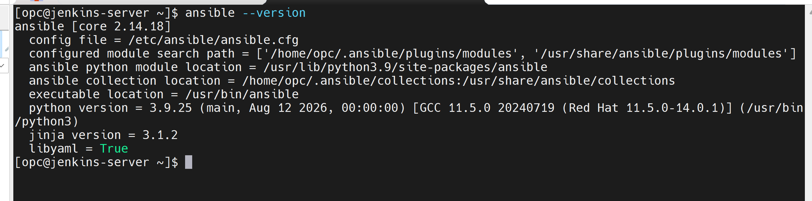

```bash
ansible-inventory -i inventory/dev.yml --graph
```
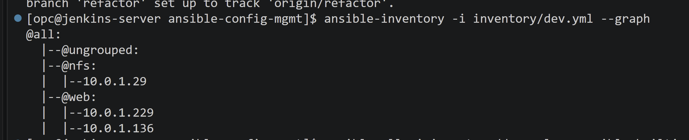
```bash
ansible all -i inventory/dev.yml -m ansible.builtin.ping
```
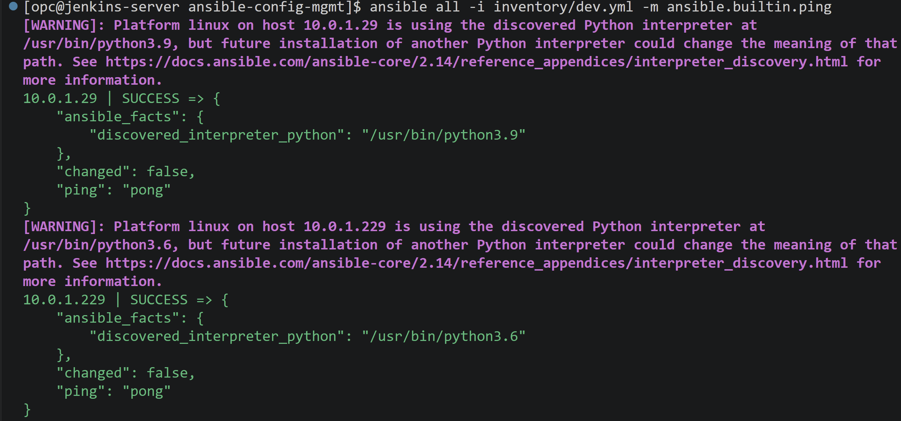

## Configure inventory and SSH

Inventory files define host groups, connection users, and private-key paths.The development inventory currently defines `nfs` and `web` groups; the UAT
inventory defines `uatweb`. 
### Update host addresses, usernames, and key paths to match your environment before use.
`inventory/staging.yml` and`inventory/prod.yml` are currently empty and do not define deployable hosts.

### Keep private keys outside the repository. Do not commit credentials, private keys, or other secrets. Use a protected key file with restrictive permissions, and verify that each account can connect to its host over SSH. For example:

```bash
ssh -i /path/to/private-key <user>@<host>
```
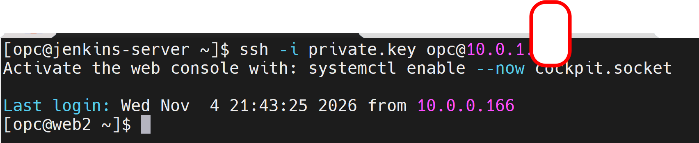

You can inspect the hosts selected by a playbook without applying changes:

```bash
ansible-playbook -i inventory/uat.yml playbooks/site.yml --list-hosts
```
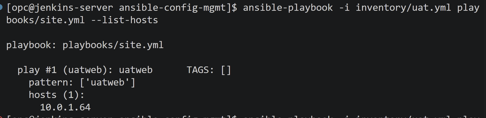
### Apply common host configuration
The common playbook targets the `nfs` and `web` groups in the selected
inventory. For the development inventory:

```bash
ansible-playbook -i inventory/dev.yml static-assignment/common.yml --syntax-check
ansible-playbook -i inventory/dev.yml static-assignment/common.yml
```
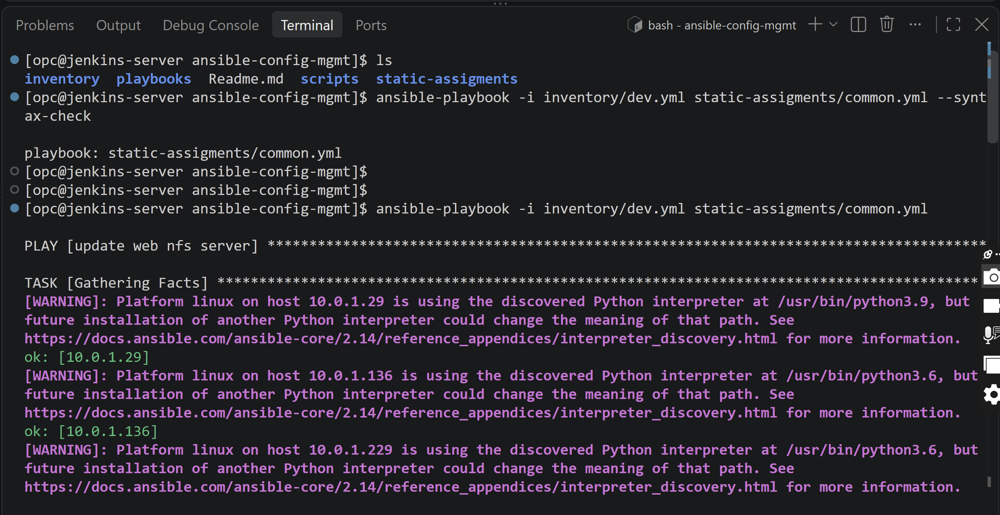

It installs Wireshark using `yum`, creates `/tmp/test_directory` and `/tmp/test_directory/test_file.txt`, displays the current timezone, sets
`Africa/Nairobi`, and runs `scripts/server-info.sh` on each target. The script reports the hostname, date, uptime, IP addresses, disk usage, and memory usage.
### Remove Wireshark

`static-assigments/common-del.yml` removes Wireshark from the `nfs` and `web`
groups. Review the target hosts before applying this change:

```bash
ansible-playbook -i inventory/dev.yml static-assigments/common-del.yml --list-hosts
ansible-playbook -i inventory/dev.yml static-assigments/common-del.yml
```

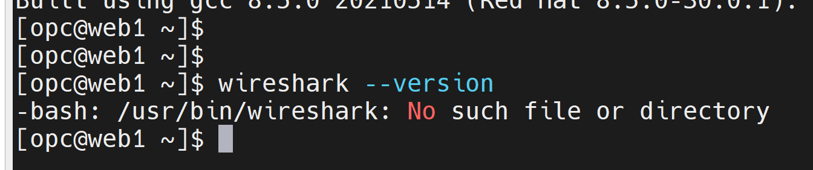

After Playbook run
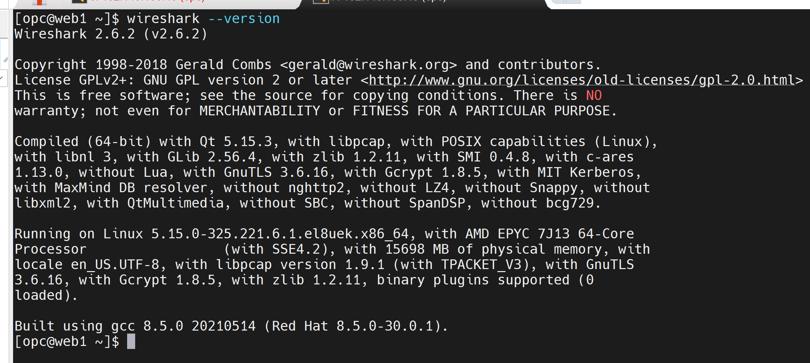

Added other tasks to teh playbook such as running a script remotely to display system info and it worked well.
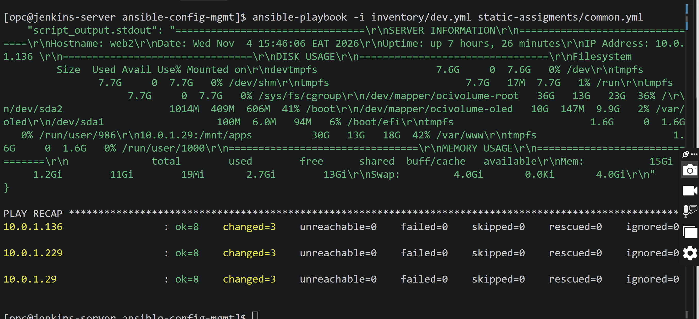
**Controller path requirement:** the playbook currently refers to the script using the absolute control-node path `/home/opc/ansible-config-mgmt/scripts/server-info.sh`. If this repository is checked out elsewhere, update that `cmd` path in `static-assigments/common.yml` before running the playbook.

### Remove Wireshark

`static-assigments/common-del.yml` removes Wireshark from the `nfs` and `web`
groups. Review the target hosts before applying this change:

### Created a Web server role and reference it in the site.yml file.
The `webserver` role was created automatically using ansible-galaxy.
```bash
ansible-galaxy init webserver
````
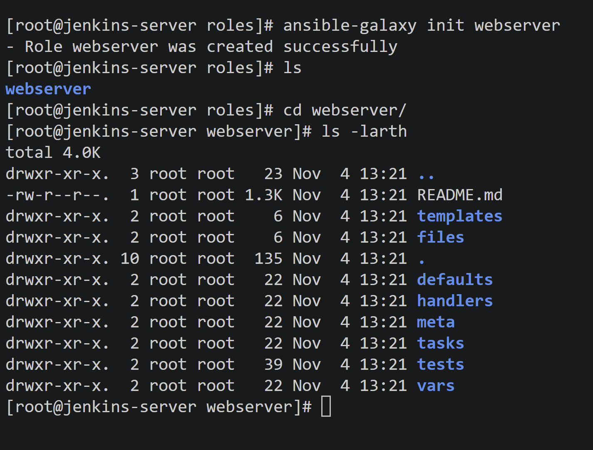
### What the role does:
1. Installs `apache2` and `git`.
2. Clones `https://github.com/tabby123-dev/tooling-solution.git` at the
   `main` branch into `/var/www/tooling`.
3. Copies `/var/www/tooling/html/` into `/var/www/html/`.
4. Starts and enables the Apache service.
5. Removes `/var/www/html/html` if it exists.

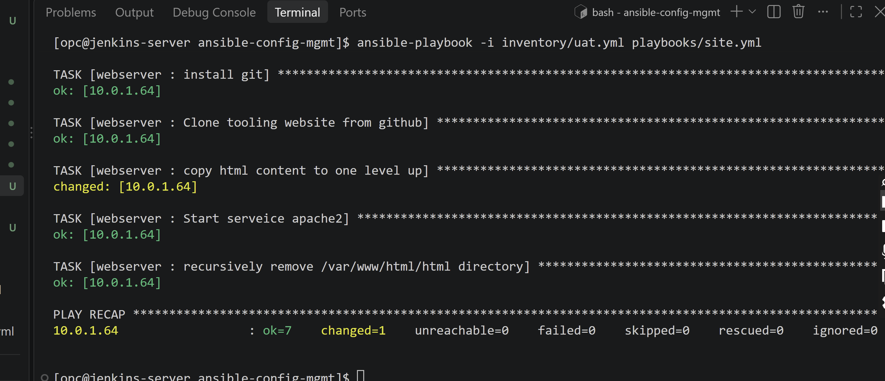
The role uses fixed paths and follows the mutable `main` branch.Also, the play does not enable privilege escalation globally while several role tasks explicitly use `become`, the service and cleanup tasks do not. Configure privilege escalation for those tasks or the play if the remote connection user is not root.

### Verify from the Load balancer you can access the website Cloned & deployed on the uat server.

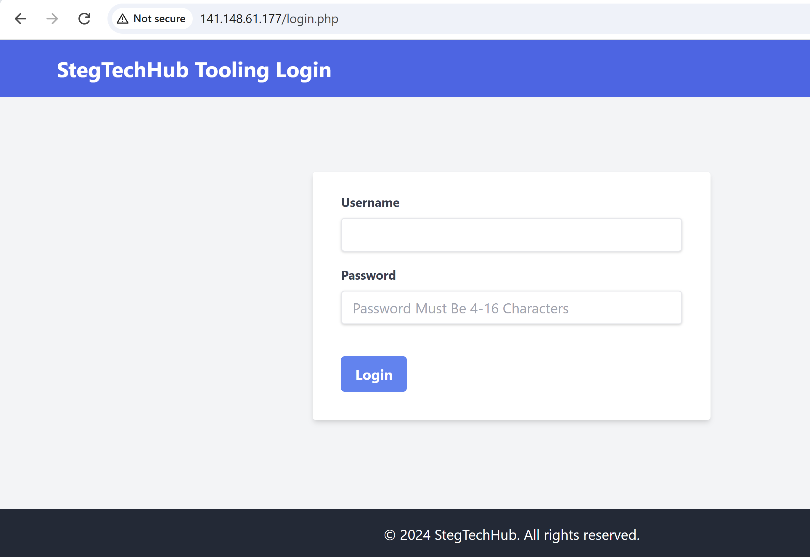


## Validation and operational notes

- Use `--syntax-check` and `--list-hosts` before applying changes.
- Ansible check mode (`--check`) can help preview supported changes, but is not
  a guarantee that every task will be simulated or validated.
- The common playbook changes the system timezone and installs software; run it
  only against intended hosts with suitable privilege.
- The common playbook uses `yum`, while the webserver role uses `apt`. Use
  inventories whose target operating systems match the relevant tasks.
- The webserver role pulls website content at run time, so deployment depends
  on GitHub availability and the selected branch contents.
- No Jenkins pipeline, CI workflow, dependency lock file, or automated test
  suite is included in this repository. Any CI/CD integration must be
  configured separately.
